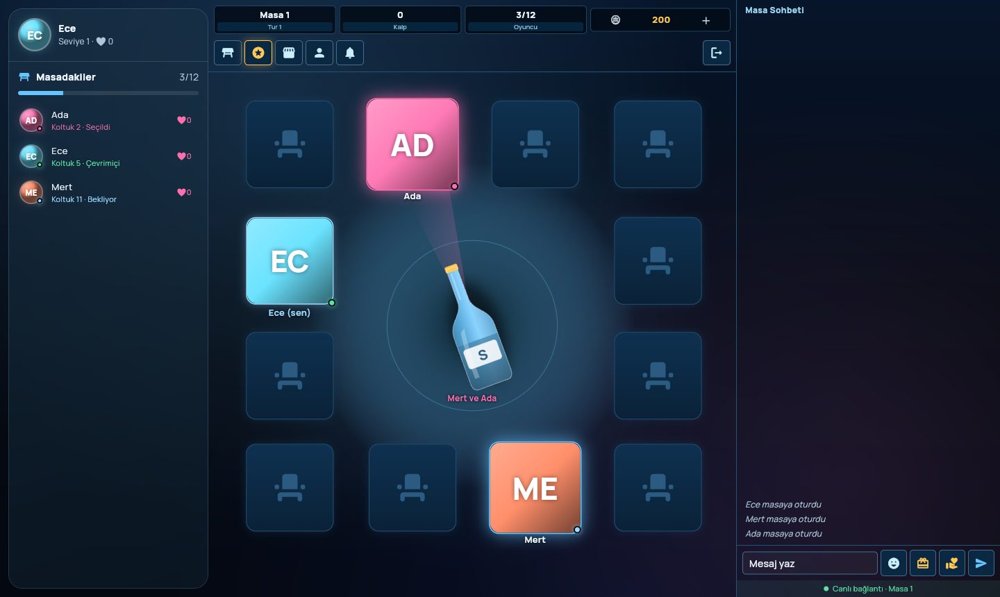
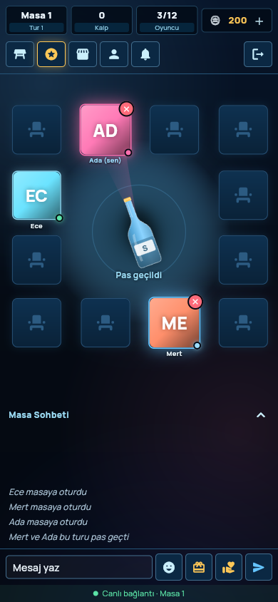
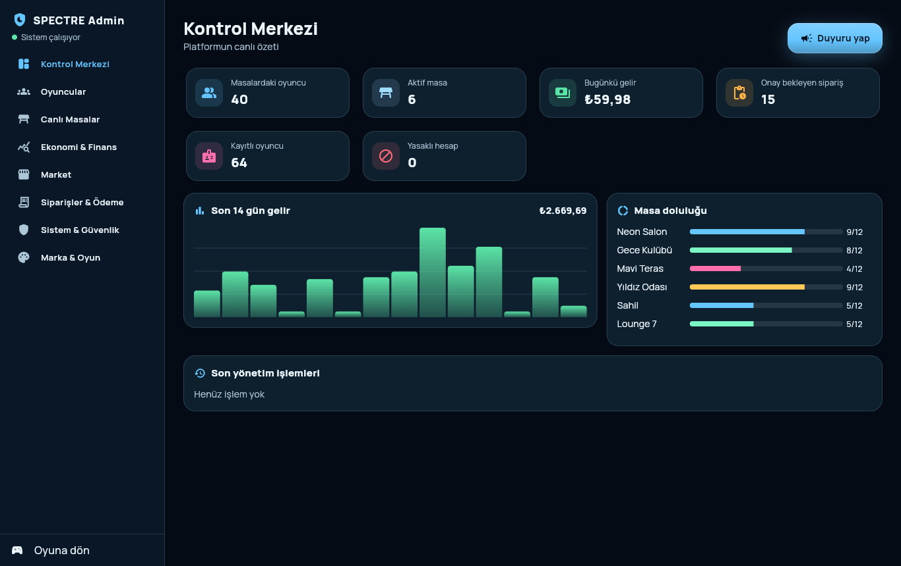
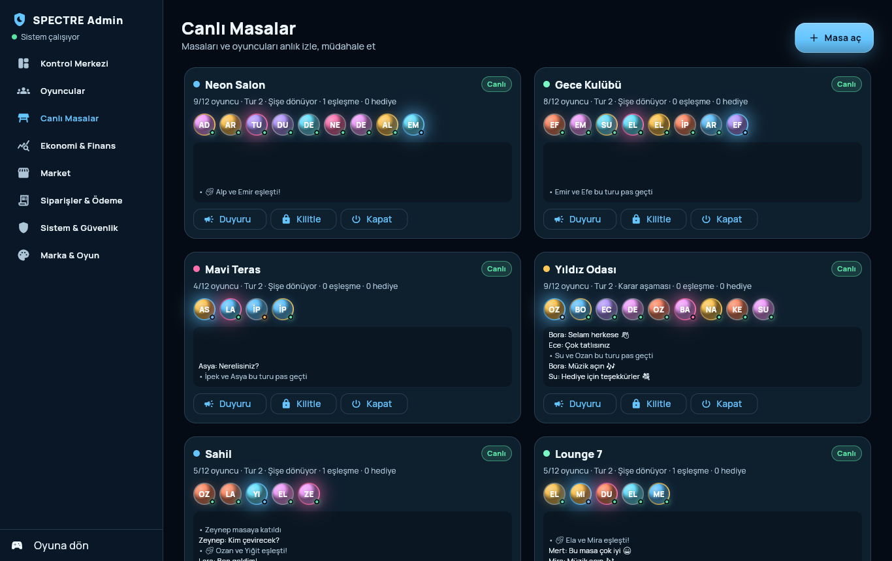

# SPECTRE (Flutter WebAssembly + kendi sunucusu)

Özgün şişe çevirme sosyal oyunu, oyun sunucusu ve yönetim merkezi.
Tüm veriler (oyuncular, masalar, koltuklar, sohbet, hediyeler, siparişler)
**SPECTRE sunucusundan** gelir; uygulamada sahte/örnek veri yoktur.

```
spectre_game/
  lib/                     Flutter uygulaması (oyun + yönetim merkezi)
  packages/spectre_core/   Ortak oyun kuralları ve protokol (sunucu + uygulama)
  server/                  Oyun sunucusu (Dart, REST + WebSocket, JSON dosyada kalıcı veri)
  deploy/                  systemd ve NGINX örnekleri
  docs/                    Geçiş planı, API, ekran görüntüleri
```

## Hızlı başlangıç

```bash
cd spectre_game
flutter pub get
flutter build web --wasm --release                     # → build/web

cd server
dart pub get
SPECTRE_ADMIN_USER=admin SPECTRE_ADMIN_PASSWORD='en-az-8-karakter' \
  dart run bin/server.dart --port 8090 --data ./data --web ../build/web
```

Tarayıcıda `http://localhost:8090` açın.

1. Menü → **Yönetim merkezi** → kullanıcı adı + şifre ile giriş.
2. `Masa 1`–`Masa 4` hazır gelir; **Canlı Masalar** bölümünden yenilerini açabilirsiniz.
3. **Market** bölümünden hediye kataloğunu ve coin paketlerini ekleyin.
4. Oyuncular **Kayıt ol** (kullanıcı adı + şifre) ya da misafir girişiyle oynar.

`SPECTRE_ADMIN_PASSWORD` verilmezse ilk açılışta rastgele bir şifre üretilir ve
`data/admin-ilk-sifre.txt` dosyasına yazılır.

## Testler

```bash
cd packages/spectre_core && dart test     # oyun kuralları (8)
cd server && dart test                    # gerçek HTTP + WebSocket uçtan uca (5)
flutter test                              # istemci masa durumu (4)
```

## Neler var

- **Masa (v39 yapısı):** 12 koltuk kare düzende — üstte 4, solda 2, sağda 2,
  altta 4; köşeleri yuvarlatılmış kare fotoğraf ve altında isim; ortada şişe,
  tur durumu ve tur düğmeleri (Otur / ÇEVİR / Pas–Kabul).
  Telefonda yukarıdan aşağı: üst bilgi çubuğu (masa adı/tur, kalp, doluluk,
  coin ＋) · araç düğmeleri (masa seçimi, bonus, market, profil, bildirimler,
  çıkış) · masa · Masa Sohbeti (genişletilebilir) · mesaj satırı (tepki,
  hediye, toplu hediye, gönder) · bağlantı durumu.
  Masaüstünde aynı sütun ortada; solda masadakiler, sağda sohbet.
  Efektler: yavaşlayarak duran dönüş, hedef ışını, süre çerçevesi, uçan
  hediye, tepkiler, eşleşme; bağlantısı kopan oyuncu soluk görünür.
- **Masalar:** ilk açılışta projedeki `Masa 1`–`Masa 4` oluşturulur; yönetim
  merkezinden eklenir/yeniden adlandırılır.
- **Sunucu yetkili:** Tur zamanlayıcısı, hedef seçimi, coin düşümü sunucuda.
  Hız sınırları, yasaklı kelime, IP engeli, hatalı giriş kilidi.
- **Yönetim merkezi:** Kontrol Merkezi, Oyuncular (coin, sustur, masadan çıkar,
  askıya al, yasakla, rol, uyarı, not, ad/şifre sıfırlama), Canlı Masalar,
  Ekonomi & Finans, Market, Siparişler & Ödeme, Sistem & Güvenlik
  (yöneticiler, şifre değiştirme, denetim kaydı), Marka & Oyun.

API ayrıntıları: [`docs/API.md`](docs/API.md) · Geçiş planı: [`docs/GECIS_PLANI.md`](docs/GECIS_PLANI.md)

Yazı tipi: Manrope, SIL Open Font License 1.1 (`assets/fonts/OFL.txt`).

## Ekran görüntüleri (gerçek sunucuyla, iki oyuncu)

| Masa (masaüstü) | Masa (telefon, v39 yapısı) |
|---|---|
|  |  |

| Kontrol Merkezi | Canlı Masalar |
|---|---|
|  |  |
